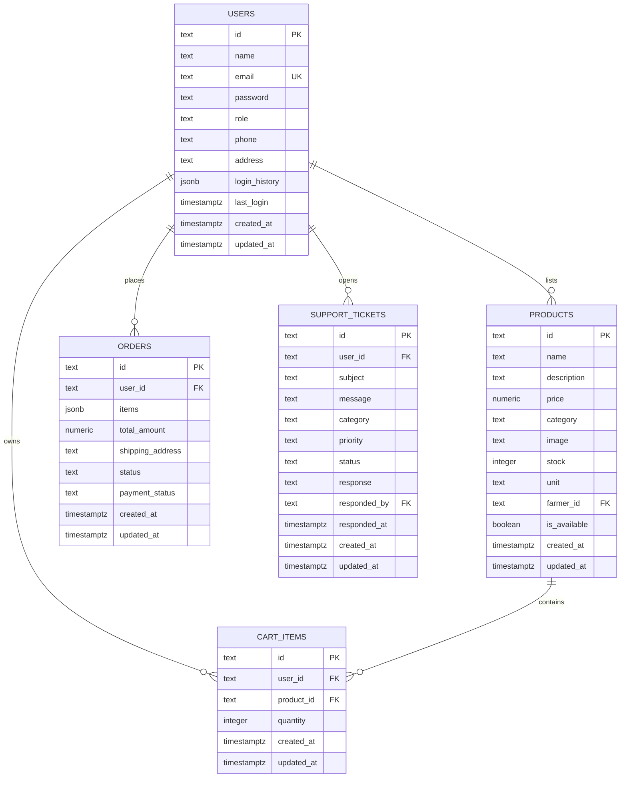

# FarmToHome Design & Architecture Specification (DESIGN.md)

This document is the authoritative source of truth for the FarmToHome application architecture, data schema, component structure, coding conventions, and deployment strategy.

---

## 1. Executive Summary & Goals

FarmToHome is a direct-to-consumer digital marketplace connecting local farmers with urban consumers. It enables transparent pricing, eliminates intermediaries, supports order tracking, customer support, and administrative management.

### Key Architectural Changes:
1. **Unified Root Structure**: Eliminate separate `frontend/` and `backend/` directories. Flatten the project into a single cohesive full-stack repository.
2. **One-Click Vercel Deployment**: Frontend static assets compiled to `build/`, backend API mounted as Vercel Serverless Functions in `api/index.js`, orchestrated through `vercel.json`.
3. **Database Migration from MongoDB to Supabase**: Replace MongoDB/Mongoose with Supabase PostgreSQL via `@supabase/supabase-js`. All relations, user auth records, products, cart items, orders, and support tickets transition to PostgreSQL tables with proper typing, indexes, and constraints.
4. **Resilient Local & Offline Fallback**: Built-in adapter that connects seamlessly to live Supabase when credentials exist, with an offline local-storage fallback mode during initial setup.

---

## 2. Directory Structure

```
FarmToHome/
├── api/                             # Serverless API routes & backend logic
│   ├── middleware/
│   │   └── auth.js                  # JWT verification & role middleware
│   ├── routes/
│   │   ├── admin.js                 # Admin management & metrics routes
│   │   ├── auth.js                  # Registration, login, profile routes
│   │   ├── cart.js                  # Cart query & item manipulation routes
│   │   ├── orders.js                # Order lifecycle & tracking routes
│   │   ├── products.js              # Product catalog CRUD routes
│   │   ├── support.js               # Customer support ticketing routes
│   │   └── users.js                 # User listing & role routes
│   ├── index.js                     # Vercel serverless function entry point
│   ├── services/
│   │   └── dbAdapter.js             # Dual-engine DB adapter (Supabase & fallback)
│   └── supabase.js                  # Supabase client initializer
├── public/                          # Static web assets
│   ├── index.html                   # HTML entry point
│   ├── favicon.ico
│   ├── logo.svg
│   └── manifest.json
├── src/                             # React SPA frontend
│   ├── components/
│   │   ├── Admin/                   # Admin management interfaces
│   │   ├── Auth/                    # Login & Register views
│   │   ├── Cart/                    # Cart & checkout preview
│   │   ├── Consumer/                # Consumer dashboard
│   │   ├── Farmer/                  # Farmer dashboard & product manager
│   │   ├── Home/                    # Landing page & hero components
│   │   ├── Layout/                  # Navbar, Footer
│   │   ├── Orders/                  # Order listing & details
│   │   ├── Products/                # Product grid & detail pages
│   │   ├── Support/                 # Ticketing & support interface
│   │   ├── Tracking/                # Order status tracking
│   │   ├── UI/                      # Shared Alerts, Spinners
│   │   └── ProtectedRoute.js        # RBAC route guard
│   ├── contexts/
│   │   └── AuthContext.js           # Auth state & provider
│   ├── services/
│   │   ├── api.js                   # Unified API HTTP client
│   │   └── supabase.js              # Frontend Supabase client helper
│   ├── styles/
│   │   └── admin.css
│   ├── utils/
│   │   ├── currency.js              # INR currency formatter
│   │   └── productImage.js          # Fallback image resolver
│   ├── App.css
│   ├── App.js
│   ├── index.css
│   └── index.js
├── supabase/
│   ├── schema.sql                   # Full Supabase PostgreSQL DDL & RLS
│   └── seed.sql                     # Seed data with default users & products
├── .env.example                     # Environment template
├── DESIGN.md                        # Architectural specification (this file)
├── package.json                     # Unified root dependencies & scripts
├── README.md                        # Documentation & setup guide
├── server.js                        # Local Node/Express development server
└── vercel.json                      # Vercel routing, rewrites, and build rules
```

---

## 3. Database Architecture (Supabase PostgreSQL)

### 3.1 Relational Schema



### 3.2 Compatibility Rule for ID Fields
Both `id` and `_id` must be returned on all entity objects in API responses to guarantee 100% interoperability with React components that inspect `_id` or `id`.

---

## 4. One-Click Vercel Deployment Specification

### 4.1 Routing & Rewrites (`vercel.json`)
```json
{
  "version": 2,
  "rewrites": [
    {
      "source": "/api/(.*)",
      "destination": "/api/index.js"
    },
    {
      "source": "/((?!api/).*)",
      "destination": "/index.html"
    }
  ]
}
```

### 4.2 Same-Origin API Calls
In `src/services/api.js`, API requests target relative `/api` on production. Because the frontend React SPA and Vercel Serverless Functions share the exact same domain:
- Zero CORS overhead.
- No third-party cookie restrictions.
- No need to configure `REACT_APP_API_URL` for Vercel production.

### 4.3 Environment Variables Required on Vercel
- `SUPABASE_URL`: Supabase project URL (`https://xyz.supabase.co`)
- `SUPABASE_ANON_KEY`: Supabase project anonymous public key
- `SUPABASE_SERVICE_ROLE_KEY`: Supabase service role key (for backend queries)
- `JWT_SECRET`: Signing key for authentication tokens

---

## 5. UI/UX & Design Guidelines

1. **Design System & Aesthetics**: Follow `DESIGN_OVERVIEW.md` guidelines:
   - Primary Green: `#2c7a2c`
   - Secondary Green: `#38a169`
   - Dark Gray: `#333333`
   - Light Background: `#f8fafb`
2. **Typography**: Clean system stack, clear font hierarchy, accessible contrast meeting WCAG AA standards.
3. **Accessibility**: Responsive, mobile-first grid, accessible labels, semantic HTML, keyboard-navigable dialogs and forms.

---

## 6. Execution & Verification Strategy

- Rebuild root package.json with unified dependencies.
- Build production bundle (`npm run build`) and assert zero syntax or build errors.
- Test server routes with automated tests verifying health, auth, products, cart, orders, and support endpoints.
- Provide SQL migration ready for Supabase Dashboard execution.
