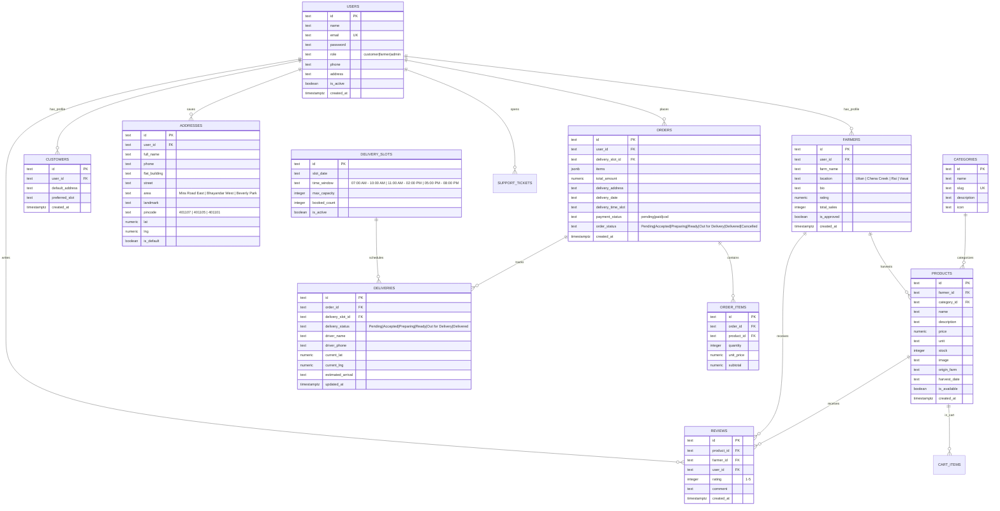

# Farm2Home Design & Architecture Specification (DESIGN.md)

This document is the authoritative source of truth for the **Farm2Home** application architecture, database schema, role-based access control, component structure, UI/UX tokens, delivery scheduling, and deployment strategy.

---

## 1. Project Overview & Problem Statement

### 1.1 College Idea Lab Context
**Farm2Home** is an agricultural technology platform designed to solve a critical regional supply chain problem:
> **Problem Statement**: Local farmers in the peri-urban belts near **Mira Bhayandar** (including Uttan, Chena Creek, Dongri, Rai-Morva, and Vasai-Virar) struggle to connect directly with urban households due to a lack of digital platforms supporting farm-to-home deliveries. They depend heavily on exploitative commission agents and intermediaries (APMC middlemen), which reduces farmer profits by 40–60%. Furthermore, irregular and uncoordinated delivery scheduling creates produce wastage and logistical difficulties.

**Farm2Home** directly connects these local cultivators with urban consumers in Mira Bhayandar, guaranteeing:
1. **Direct Farm-to-Consumer Marketplace**: 0% intermediary markup, fair farm-gate pricing for farmers, and fresher produce for consumers.
2. **Coordinated Delivery Slots**: Predictable morning (7–10 AM), afternoon (12–3 PM), and evening (5–8 PM) delivery windows with automated capacity caps that prevent overbooking.
3. **Transparent 6-Stage Tracking & Route Map**: End-to-end visibility from field harvest to doorstep (`Pending` → `Accepted` → `Preparing` → `Ready` → `Out for Delivery` → `Delivered`) with Mira Bhayandar sector routing.
4. **Inclusive Farmer Experience**: Intuitive, high-contrast dashboard with image uploads and one-click order fulfillment designed for non-technical rural cultivators.

---

## 2. Directory Structure

```
FarmToHome-main/
├── api/                             # Serverless API routes & backend logic
│   ├── middleware/
│   │   └── auth.js                  # JWT verification & RBAC (Customer, Farmer, Admin)
│   ├── routes/
│   │   ├── admin.js                 # Admin analytics, farmer approvals, slot manager
│   │   ├── auth.js                  # Register, login, profile, farmer status
│   │   ├── cart.js                  # Cart management & reservation
│   │   ├── delivery.js              # Delivery slots, booking capacity & map tracking
│   │   ├── orders.js                # Order lifecycle & 6-stage status updates
│   │   ├── products.js              # Product catalog CRUD & categories
│   │   ├── reviews.js               # Product & farmer reviews/ratings
│   │   ├── support.js               # Customer support ticketing routes
│   │   └── users.js                 # User listing & role routes
│   ├── index.js                     # Vercel serverless function entry point
│   ├── services/
│   │   └── dbAdapter.js             # Dual-engine DB adapter (Supabase PostgreSQL + local JSON fallback)
│   └── supabase.js                  # Supabase client initializer
├── public/                          # Static assets
│   ├── index.html                   # HTML entry point (Farm2Home title & meta)
│   ├── favicon.ico
│   └── manifest.json
├── src/                             # React SPA frontend
│   ├── components/
│   │   ├── Admin/                   # Admin Dashboard, Farmer Approvals, Delivery Slots, Products, Orders
│   │   ├── Auth/                    # Login, Register with Role Selector (Consumer vs Farmer)
│   │   ├── Cart/                    # Cart & Multi-Step Checkout (Address & Slot selection)
│   │   ├── Consumer/                # Consumer Account & Order History
│   │   ├── Delivery/                # Interactive Delivery Route Map & Slot Picker
│   │   ├── Farmer/                  # Farmer Hub, Product Manager, Order Fulfillment
│   │   ├── Home/                    # Landing page, Hero, Mira Bhayandar showcase, Farmers, How It Works, Benefits, Sustainability
│   │   ├── Layout/                  # Farm2Home Navbar & Editorial Cream/Green Footer
│   │   ├── Orders/                  # Order listing & details
│   │   ├── Products/                # Product grid, Category filter, Search, Product Detail with Reviews
│   │   ├── Support/                 # Ticketing & support interface
│   │   ├── Tracking/                # 6-Stage Stepper & Interactive Mira Bhayandar Delivery Map
│   │   ├── UI/                      # ImageUpload, Skeletons, Alerts, Motion wrappers
│   │   └── ProtectedRoute.js        # RBAC route guard
│   ├── contexts/
│   │   └── AuthContext.js           # Auth state & provider
│   ├── services/
│   │   └── api.js                   # Unified API HTTP client
│   ├── styles/
│   │   ├── admin.css                # Admin portal styling
│   │   └── delivery.css             # Delivery slots & map tracking styling
│   ├── utils/
│   │   ├── currency.js              # INR (₹) formatter
│   │   └── productImage.js          # Fallback image resolver
│   ├── App.css                      # Global theme styles (green, white, cream)
│   ├── App.js                       # Route declarations
│   ├── index.css
│   └── index.js
├── supabase/
│   ├── schema.sql                   # Supabase PostgreSQL DDL, Foreign Keys & RLS
│   └── seed.sql                     # Seed data with Mira Bhayandar farmers & products
├── .env.example
├── DESIGN.md                        # Authoritative architecture specification (this file)
├── package.json
├── README.md
├── server.js                        # Local Express server
└── vercel.json
```

---

## 3. Database Architecture (Supabase PostgreSQL & Fallback)

### 3.1 Relational Schema Diagram



---

## 4. Operational Workflows & Business Logic

### 4.1 Delivery Slots & Overbooking Prevention
1. **Slot Capacity Model**: Each time slot has a strict `max_capacity` (e.g., 20 deliveries per morning window in Mira Bhayandar).
2. **Concurrency Check**: During checkout, the backend checks `booked_count < max_capacity` in an atomic transaction. If the slot is filled, the UI disables that slot and prompts the user to select an alternative.
3. **Slot Auto-Creation**: System automatically exposes valid delivery slots for Today (if before cutoff) and the next 3 days.

### 4.2 Order Lifecycle (6-Stage Pipeline)
```
[1. Pending] (Customer places order with selected slot)
     │
     ▼
[2. Accepted] (Farmer or Admin confirms harvest availability)
     │
     ▼
[3. Preparing] (Produce picked, cleaned, weighed, and packed at farm)
     │
     ▼
[4. Ready] (Packed crate transferred to local Mira Bhayandar transit hub)
     │
     ▼
[5. Out for Delivery] (Assigned to local electric delivery van / rider with ETA)
     │
     ▼
[6. Delivered] (Order handed over to customer doorstep with confirmation)
```

### 4.3 Farmer Onboarding & Admin Approval
- New farmers registering via `/register` are tagged `is_approved: false`.
- Admin dashboard features a dedicated **Farmer Approvals** tab. Admin reviews farm location (e.g. Uttan/Chena), crops, and contact number before toggling approval.
- Approved farmers gain access to the Farmer Hub to list crops and fulfill orders.

---

## 5. UI/UX Design System & Color Palette

The visual identity embodies fresh agricultural harvest with an editorial, organic aesthetic:

### 5.1 Color Tokens
- **Leaf Green (Primary)**: `#236838`
- **Forest Green (Hover/Focus)**: `#1b4d29`
- **Pastel Mint (Subtle Accents)**: `#e8f5e9`
- **Heritage Cream (Page Background)**: `#fcfbf7`
- **Warm Sand (Card Background)**: `#f7f4ec`
- **Pure White (Surfaces)**: `#ffffff`
- **Earth Brown (Text & Headings)**: `#262a24`
- **Muted Olive (Secondary Text)**: `#5a6552`
- **Golden Harvest (Warning/Pending)**: `#d97706`
- **Fresh Tomato (Urgent/Error)**: `#dc2626`

### 5.2 Layout & Responsiveness
- **Desktop**: Clean grid with editorial provenance tags and generous white space.
- **Mobile**: Responsive touch targets (min 44px), sticky bottom navigation for cart & actions, streamlined multi-step forms.
- **Accessibility**: High-contrast ratios (> 4.5:1), semantic labels, keyboard navigable modals and radio controls.

---

## 6. Execution & Verification Strategy
1. **Update Database Schema & Seed Data**: Reflect the 11 tables with Mira Bhayandar locations and authentic Indian crops in `supabase/schema.sql` and `api/services/dbAdapter.js`.
2. **Build Delivery & Review API Routes**: Add routes for slot query/booking, map tracking, farmer approval, and product reviews.
3. **Enhance Frontend Components**:
   - Update `Home.js` with Farm2Home branding, Mira Bhayandar context, Idea Lab badge, local farmers, and sustainability.
   - Update `Navbar.js` and `Footer.js` with Farm2Home branding and Mira Bhayandar fulfillment details.
   - Update Checkout with Mira Bhayandar address selector & delivery slot capacity picker.
   - Update `OrderTracking.js` with the 6-stage delivery stepper & interactive route map.
   - Update Farmer Dashboard with approval status, order acceptance, and status updating.
   - Update Admin Dashboard with Farmer Approvals and Delivery Slot management.
4. **Automated & Manual Verification**:
   - Run API endpoint test suite.
   - Run `npm test` and `npm run build` to confirm 0 compilation errors.
   - Verify server running on port 5001 and UI on port 3000.
